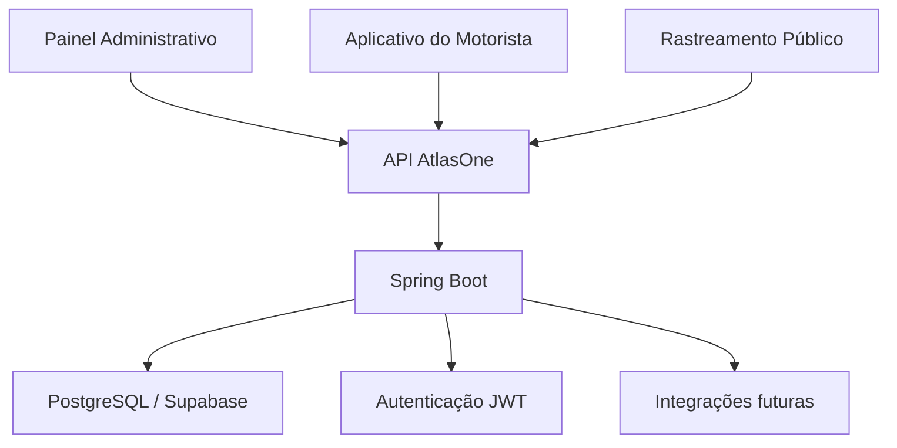

# AtlasOne

<p align="center">
  <strong>Logística inteligente. Operações sob controle.</strong>
</p>

<p align="center">
  Plataforma SaaS de gestão logística desenvolvida para conectar pedidos, operações e entregas em um único ambiente.
</p>

<p align="center">
  
  
  
  
  
  
</p>

---

## Sobre o projeto

O **AtlasOne** é um projeto de SaaS (Software as a Service) focado na gestão logística de operações de e-commerce com frota própria.

A proposta é centralizar o fluxo logístico em uma única plataforma, permitindo que empresas tenham maior controle sobre seus pedidos, entregas, motoristas e operações.

Mais do que acompanhar entregas, o objetivo é conectar todas as etapas da operação logística, desde a preparação do pedido até a confirmação de recebimento pelo cliente.

### O problema

Operações de e-commerce frequentemente precisam lidar com informações espalhadas entre diferentes sistemas, controles manuais, comunicação descentralizada e pouca visibilidade sobre o andamento das entregas.

O AtlasOne nasce com o propósito de reduzir essa fragmentação e oferecer uma visão centralizada da operação.

### A proposta

Uma plataforma com três frentes principais:

- **Painel administrativo:** gerenciamento e acompanhamento da operação logística.
- **Aplicativo do motorista:** acesso às entregas, organização das rotas e atualização dos status.
- **Rastreamento público:** acompanhamento da entrega pelo cliente através de um link exclusivo, sem necessidade de criar uma conta.

---

## Objetivos da plataforma

O AtlasOne está sendo desenvolvido com foco nas seguintes capacidades:

| Área | Objetivo |
|---|---|
| Gestão de pedidos | Centralizar os pedidos recebidos pela operação |
| Gestão de entregas | Organizar e acompanhar as entregas |
| Gestão de motoristas | Controlar usuários e atribuições operacionais |
| Planejamento de rotas | Organizar sequências de entregas |
| Rastreamento | Disponibilizar acompanhamento público |
| Integrações | Conectar sistemas de e-commerce e gestão |
| Indicadores | Oferecer visibilidade sobre o desempenho logístico |

Essas capacidades representam a visão de produto. Nem todas estão implementadas na versão atual.

---

## Arquitetura

O projeto está organizado em uma arquitetura separada por responsabilidades.



### Componentes

**Frontend**

Responsável pela interface web administrativa e pela experiência de utilização da plataforma.

**Backend**

Responsável pelas regras de negócio, autenticação, processamento de requisições e comunicação com o banco de dados.

**Banco de dados**

Responsável pela persistência das informações e pelo isolamento dos dados das organizações.

**Integrações**

Camada planejada para conectar plataformas externas e serviços utilizados nas operações de e-commerce.

---

## Tecnologias utilizadas

### Backend

| Tecnologia | Utilização |
|---|---|
| Java 21 | Linguagem principal |
| Spring Boot 4.1.2 | Framework da aplicação |
| Spring Security | Segurança e autenticação |
| JWT | Autenticação baseada em tokens |
| Spring Data JPA | Persistência e acesso a dados |
| PostgreSQL | Banco de dados relacional |
| Supabase | Infraestrutura PostgreSQL |
| Flyway | Controle de versões do banco |
| Maven | Gerenciamento de dependências |
| Spring Boot Actuator | Monitoramento da aplicação |

### Frontend

| Tecnologia | Utilização |
|---|---|
| React 19 | Construção da interface |
| TypeScript 6 | Tipagem estática |
| Vite 8 | Ambiente de desenvolvimento e build |
| React Router | Navegação |
| Lucide React | Ícones |
| Recharts | Gráficos e visualização de dados |
| CSS | Estilização da interface |

### Infraestrutura

- Git e GitHub para versionamento.
- Supabase para banco de dados PostgreSQL.
- Docker e Docker Compose para suporte à conteinerização.

---

## Estrutura do repositório

```text
AtlasOne/
│
├── backend/
│   └── atlasone-api/
│       ├── src/
│       │   ├── main/
│       │   │   ├── java/com/atlasone/api/
│       │   │   │   ├── auth/
│       │   │   │   ├── bootstrap/
│       │   │   │   ├── common/
│       │   │   │   ├── delivery/
│       │   │   │   ├── organization/
│       │   │   │   └── user/
│       │   │   │
│       │   │   └── resources/
│       │   │       └── db/migration/
│       │   │
│       │   └── test/
│       │
│       ├── .env.example
│       ├── Dockerfile
│       ├── mvnw
│       ├── mvnw.cmd
│       ├── pom.xml
│       └── run.ps1
│
├── frontend/
│   ├── public/
│   └── src/
│       ├── layouts/
│       ├── pages/
│       ├── App.tsx
│       ├── App.css
│       ├── index.css
│       └── main.tsx
│
├── docker-compose.yml
└── README.md
```

---

## Banco de dados

O AtlasOne utiliza PostgreSQL, com o Supabase como infraestrutura de banco de dados.

As alterações estruturais são controladas pelo Flyway, através de migrations versionadas.

### Histórico de migrations

| Versão | Estrutura |
|---|---|
| V1 | Tabelas principais |
| V2 | Clientes e pedidos |
| V3 | Itens de pedidos e eventos |
| V4 | Entregas e volumes |
| V5 | Atribuições de motoristas e rotas |
| V6 | Regras de rotas e atribuições |
| V7 | Autenticação de usuários |
| V8 | Tokens de atualização de sessão |

**Importante:** migrations já aplicadas não devem ser editadas. Novas alterações no banco devem ser adicionadas através de novas migrations.

---

## Segurança e autenticação

A autenticação utiliza Spring Security e JWT.

A estrutura atual contempla:

- Autenticação de usuários.
- Senhas armazenadas com hash.
- Tokens de acesso.
- Estrutura de refresh tokens.
- Rotação de refresh tokens.
- Organização associada aos usuários.

O projeto segue uma arquitetura multi-tenant: os dados operacionais devem ser isolados por organização.

### Modelo de usuários

Os usuários pertencem a uma organização e possuem papéis de acesso.

A estrutura contempla administradores e motoristas.

Os clientes finais não precisam de contas na plataforma. O modelo de produto prevê o acesso ao rastreamento por meio de um link público exclusivo associado à entrega.

---

## Executando o projeto localmente

### Pré-requisitos

Antes de iniciar, tenha instalado:

- Git
- Java 21
- Node.js
- npm
- Acesso a um banco PostgreSQL compatível

### 1. Clonar o repositório

```bash
git clone https://github.com/LucasSilva2005/AtlasOne.git
```

```bash
cd AtlasOne
```

### 2. Configurar o backend

Entre na pasta:

```bash
cd backend/atlasone-api
```

Crie o arquivo de ambiente:

```powershell
Copy-Item .env.example .env
```

Configure no arquivo `.env` os dados de conexão do PostgreSQL:

```env
DB_HOST=seu_host
DB_PORT=5432
DB_NAME=postgres
DB_USER=seu_usuario
DB_PASSWORD=sua_senha
JWT_SECRET=seu_segredo_criptografico
```

O segredo JWT deve ser forte, aleatório e mantido em sigilo.

O arquivo `.env` não deve ser enviado ao GitHub.

Para iniciar o backend no Windows:

```powershell
.\run.ps1
```

O script carrega as variáveis de ambiente, configura a conexão JDBC e inicia a aplicação através do Maven Wrapper.

A API utiliza a porta `8080` por padrão.

### 3. Configurar o frontend

Abra outro terminal e entre na pasta:

```bash
cd frontend
```

Instale as dependências:

```bash
npm install
```

Inicie o ambiente de desenvolvimento:

```bash
npm run dev
```

A interface estará disponível em:

```text
http://localhost:5173
```

### 4. Validar o frontend

Executar a análise estática:

```bash
npm run lint
```

Gerar o build de produção:

```bash
npm run build
```

Visualizar o build:

```bash
npm run preview
```

---

## API

A API segue o padrão REST e utiliza versionamento de rotas.

Prefixo:

```text
/api/v1
```

### Endpoints disponíveis na implementação atual

| Método | Endpoint | Descrição |
|---|---|---|
| POST | `/api/v1/auth/login` | Autenticação de usuário |
| GET | `/actuator/health` | Verificação de saúde da aplicação |

O serviço de rotação de refresh tokens já possui implementação interna, mas seu endpoint HTTP ainda precisa ser disponibilizado.

Os demais módulos da plataforma estão em desenvolvimento.

---

## Identidade visual

O AtlasOne possui uma identidade visual baseada em tecnologia, confiança e simplicidade.

| Elemento | Cor |
|---|---|
| Fundo principal | `#071426` |
| Azul tecnológico | `#087BFF` |
| Superfícies secundárias | `#152238` |
| Tipografia e contraste | `#FFFFFF` |

A proposta visual busca transmitir uma experiência profissional, moderna e objetiva.

---

## Roadmap

O desenvolvimento está organizado em etapas para construir uma base sólida antes de ampliar as funcionalidades.

### Fundação técnica

- [x] Estrutura inicial do repositório
- [x] Configuração do backend Spring Boot
- [x] Conexão com PostgreSQL / Supabase
- [x] Estrutura inicial de migrations
- [x] Estrutura de autenticação JWT
- [x] Serviço de refresh token e rotação
- [x] Estrutura inicial do frontend React
- [x] Dashboard administrativo demonstrativo

### Próximas etapas

- [ ] Integração do frontend com o backend
- [ ] Integração das rotas do React Router com o layout
- [ ] Tela de login e gerenciamento de sessão
- [ ] Gestão de organizações e usuários
- [ ] Gestão de pedidos
- [ ] Gestão de entregas
- [ ] Gestão de motoristas
- [ ] Planejamento e acompanhamento de rotas
- [ ] Rastreamento público de entregas
- [ ] Integração com Bling
- [ ] Notificações e comunicação com clientes
- [ ] Aplicativo do motorista
- [ ] Indicadores e relatórios operacionais
- [ ] Testes automatizados e preparação para produção

O roadmap representa a direção planejada do projeto e poderá ser atualizado conforme a evolução do desenvolvimento.

---

## Princípios do projeto

O desenvolvimento do AtlasOne é guiado por alguns princípios:

**Organização:** código estruturado e responsabilidades bem definidas.

**Escalabilidade:** arquitetura preparada para atender diferentes organizações.

**Segurança:** proteção de credenciais, sessões e dados operacionais.

**Integração:** capacidade de comunicação com diferentes sistemas.

**Usabilidade:** interfaces claras e processos operacionais objetivos.

**Evolução contínua:** implementação incremental, com validação a cada etapa.

---

## Status do desenvolvimento

O AtlasOne está em fase de desenvolvimento.

A fundação técnica do backend, a estrutura inicial do banco de dados, a autenticação e o primeiro dashboard administrativo já foram iniciados.

A integração entre os módulos e a implementação dos fluxos operacionais completos fazem parte das próximas etapas.

---

## Repositório

<p align="center">
  <a href="https://github.com/LucasSilva2005/AtlasOne">
    <strong>github.com/LucasSilva2005/AtlasOne</strong>
  </a>
</p>

---

<p align="center">
  <strong>AtlasOne</strong>
  <br />
  Logística inteligente. Operações sob controle.
  <br />
  <sub>Projeto em desenvolvimento.</sub>
</p>
